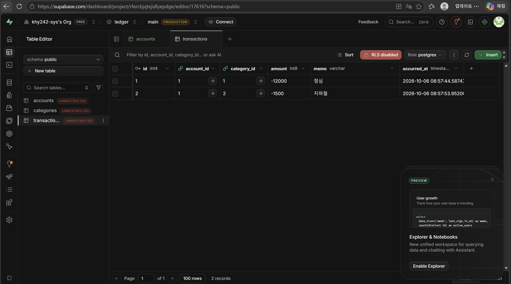

- GitHub: https://github.com/khy242-sys/ledger-api
- Render: https://ledger-api-rlk3.onrender.com/docs

# 가계부 API (4주차 · PostgreSQL과 Supabase)

FastAPI + SQLAlchemy로 만든 가계부 API입니다. 데이터는 Supabase(클라우드 PostgreSQL, 서울 리전)에 저장됩니다.

## 엔드포인트

| 메서드 | 경로 | 설명 |
|---|---|---|
| POST | /accounts | 계좌 생성 |
| GET | /accounts | 계좌 목록 |
| GET | /accounts/{account_id} | 계좌 단건 조회 |
| POST | /transactions | 거래 생성 (없는 계좌면 404) |
| GET | /accounts/{account_id}/detail | 계좌 + 거래 목록 (중첩 응답) |
| GET | /stats/by-category | 카테고리별 지출 합계 |

## ① 결과 확인

- Supabase Table Editor에서 accounts 1건(월급통장), categories 2건(식비, 교통), transactions 2건(점심, 지하철)을 확인했다.
- `GET /accounts/1/detail` 응답에 거래 2건이 중첩되어 나왔다.
- `GET /stats/by-category` 결과: 식비 -12000, 교통 -1500

## ② 핵심 개념 되새김

- **계좌와 거래를 두 테이블로 나눈 이유 (1:N)**: 계좌 하나에 거래가 여러 개 생기기 때문이다. 거래에는 계좌 이름을 복사하지 않고 계좌 id만 외래키로 저장한 뒤, 필요할 때 JOIN으로 이름을 붙인다. 이렇게 하면 계좌 정보를 한 곳에서만 고치면 되고, 외래키 덕분에 존재하지 않는 계좌의 거래는 DB가 받아 주지 않는다.
- **모델 클래스와 실제 테이블의 대응**: `class Account(Base)` 하나가 `accounts` 테이블 하나가 된다. 단계 1에서 직접 쓴 `CREATE TABLE`을 `create_all()`이 클래스 정의를 보고 대신 만들어 줬다. `Mapped[str]`은 NOT NULL, `Mapped[str | None]`은 NULL 허용, `ForeignKey("accounts.id")`는 외래키가 된다.
- **접속 문자열을 .env로 분리하는 이유**: 접속 문자열에 DB 비밀번호가 그대로 들어 있어서 코드나 GitHub에 올라가면 안 된다. `.env`는 `.gitignore`로 Git에서 제외한다. 또 로컬과 배포 서버(Render)의 DB 주소가 달라도 코드는 그대로 두고 환경변수 값만 바꾸면 된다.

## ③ 자유 로그

**배운 것**
- 같은 SQL(INSERT, JOIN, GROUP BY)을 SQLite 파일 DB, Supabase SQL Editor, SQLAlchemy 코드 세 가지 방식으로 실행해 보면서, 도구는 달라도 SQL의 뜻은 같다는 걸 알게 됐다.
- 트랜잭션: 이체 코드 중간에 일부러 오류를 넣었더니, 출금이 이미 실행됐는데도 rollback이 되돌려서 잔액이 그대로였다. "전부 되거나 전부 안 되거나"가 원자성이라는 걸 눈으로 확인했다.
- `echo=True` 덕분에 `/docs`에서 버튼을 누를 때마다 실제 실행되는 SQL이 터미널에 찍혀서, ORM이 뒤에서 무엇을 하는지 볼 수 있었다.
- `relationship`을 쓰면 `return account` 한 줄만으로 거래 목록까지 중첩되어 나온다.

**막힌 곳과 해결**
- Supabase Connect 화면의 연결 문자열 칸은 읽기 전용이라 수정이 안 됐다 → 문자열을 복사해서 `.env` 파일에서 직접 `postgresql+psycopg://`로 바꾸고 비밀번호를 넣었다.
- `pip install` 후 VS Code가 "전역 환경에 설치했다"는 경고를 띄웠다 → `pip -V`로 설치 위치가 `ledger-api\.venv`인 것을 확인했고, 경고는 무시했다.
- `.env` 확인 명령에서 괄호를 하나 빠뜨려 `SyntaxError`가 났다 → 다시 입력해서 해결했다.
- 처음 VS Code 터미널을 열었을 때 3주차(expense-api)의 가상환경이 자동으로 켜져 있었다 → `deactivate`로 끄고 새 폴더에서 `.venv`를 따로 만들었다.
- 실습 중간에 `.env`가 열린 화면을 캡처해서 비밀번호가 노출됐다 → 앞으로는 캡처 전에 `.env` 탭을 닫고, push 전에 `git status`로 `.env`가 빠졌는지 확인하기로 했다.

**아직 안 풀린 것**
- Supabase 테이블 옆의 `UNRESTRICTED`(RLS 꺼짐) 표시가 정확히 어떤 보안 의미인지, 언제 켜야 하는지 더 알아봐야 한다.
- VS Code Problems 탭의 경고들(인터프리터 선택 문제로 추정)은 실행에 영향이 없어서 그대로 두었다.
- 확장 단계 6·7(Alembic 마이그레이션, 이체 API, N+1, 인덱스)은 아직 하지 않았다.

**AI 활용**
- Claude에게 워크북 단계를 하나씩 안내받았고, 이 README의 초안 작성도 도움을 받았다. 각 단계에서 터미널 출력, `/docs` 응답 코드(201/200), Supabase Table Editor 화면을 워크북의 예상 결과와 직접 비교해서 검증했다.